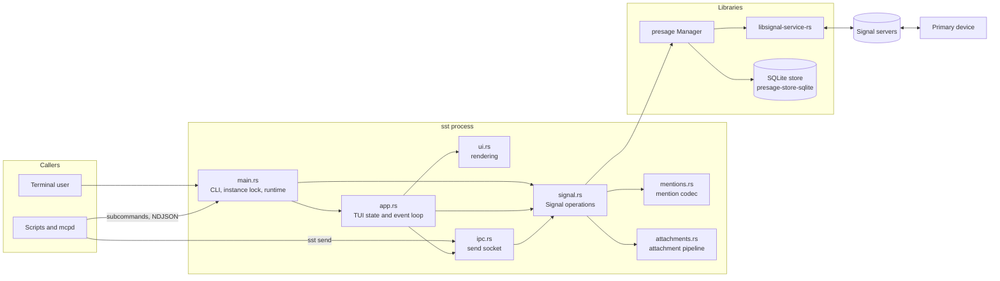
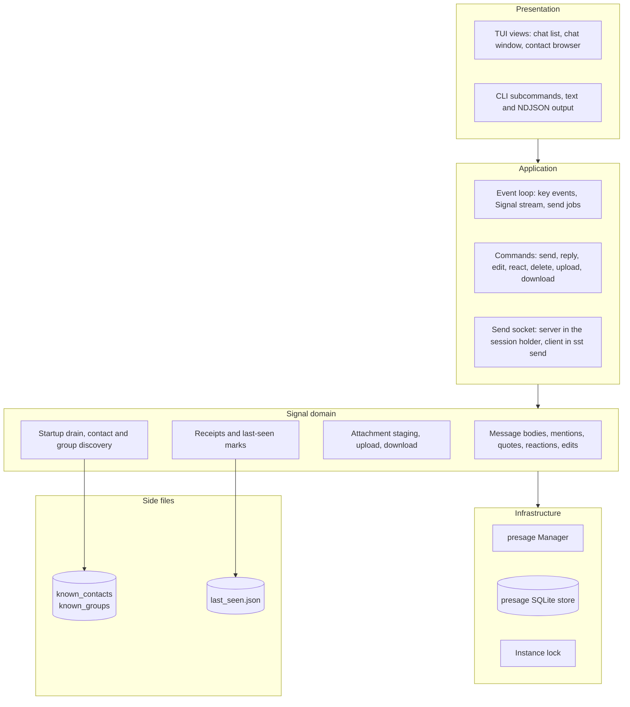
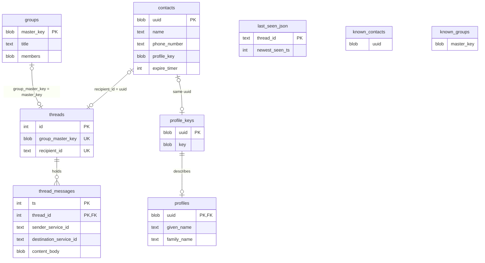

# Architecture

## High-level architecture

Primary components are the seven source files and presage. Secondary components are the libraries presage builds on and the external parties sst talks to.

## Block diagram

Primary layers top to bottom. The secondary layer on the right holds the side files sst keeps next to presage's store.

## Data model

The SQLite store belongs to presage; sst reads it through the store API and never touches the schema. Shown are the tables sst depends on. The three side files are sst's own and are listed as entities for completeness; they are flat files, not tables.

A row in `thread_messages` is a serialized `Content`, which is not always a message: receipts, remote deletes, call signalling and edit records share the table. `content_body` decides what a row is.
